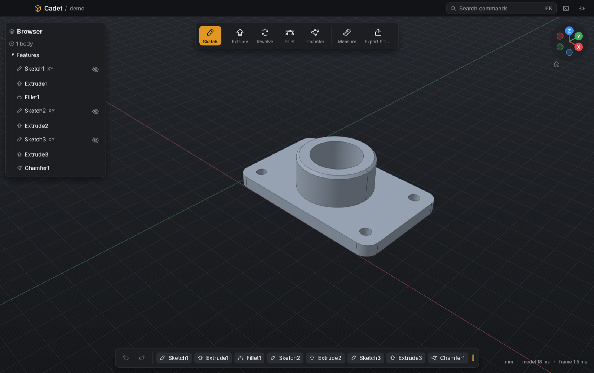
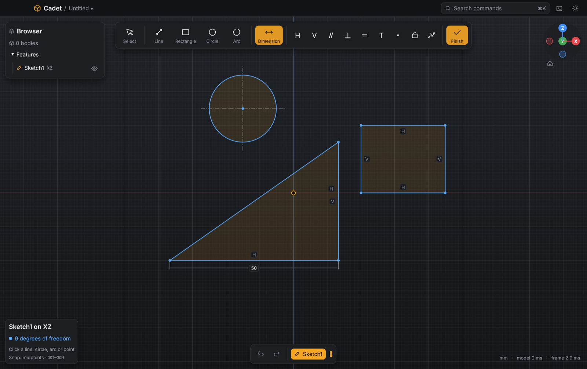

<p align="center">
  
</p>

<h1 align="center">Cadet</h1>

<p align="center">
  <b>Fast, free, local-first parametric CAD for makers.</b><br>
  Sketch → constrain → extrude, revolve, fillet → export STL/STEP to your 3D printer. Imports STEP/IGES from other CAD tools.
</p>

<p align="center">
  <a href="https://github.com/hugodrak/cadet/actions/workflows/ci.yml"></a>
  <a href="https://github.com/hugodrak/cadet/releases"></a>
  <a href="LICENSE"></a>
  
  
</p>

<p align="center">
  
</p>

## Why Cadet
- **Fast.** Opens in about half a second. The viewport renders on the GPU (wgpu), and modeling runs in a separate process, so the UI never freezes.
- **Local only.** No account, no cloud, no telemetry, no subscription. Designs are plain JSON `.cadet` files on your disk.
- **A real solid-modeling kernel.** Built on OpenCascade, so fillets, chamfers and booleans are exact B-rep, not meshes. Measurements come straight from the exact geometry.
- **Made for the 3D-printing loop.** Binary STL with a quality setting, STEP for everything else.
- **Scriptable.** Built-in Python console and plugins, with nothing to install.
- **One download.** A single self-contained app for macOS, Windows and Linux.

## Features
- **Sketching** with lines, rectangles, circles and arcs, and a live constraint solver: horizontal/vertical, parallel, perpendicular, equal, tangent, coincident, fix, and dimensions
- **Smart snapping** to endpoints, centers, midpoints and 1/n points (⌘1–⌘9), centerlines and their intersections, and existing model edges
- **Construction geometry** and center marks
- **Extrude and revolve** (new body, join, cut) with drag handles. Extrude switches between Join and Cut automatically as you drag into or out of the part.
- **Fillet and chamfer** on any edges, with a drag handle for the size
- **Sketch on any flat face** of the model
- **Editable timeline:** double-click any feature to change it, and the model rebuilds
- **Measure** distances, ΔXYZ, exact edge lengths and diameters, model size, volume and surface area
- **Import STEP and IGES** from other CAD programs as exact solids you can measure, fillet, cut and sketch on. Drag a file onto the window or use File → Import (⇧⌘I).
- **Export** binary STL (Coarse/Normal/Fine) and STEP
- **Python** console and `@cadet.command` plugins, which get an auto-generated form for their parameters
- **Command palette** (⌘K), undo/redo, autosave, session restore, and dark and light themes

<p align="center">
  
</p>

## Install
Download the build for your OS from the GitHub Releases page. It's a single self-contained app with nothing else to install:

| OS | File | Notes |
|---|---|---|
| macOS (Apple Silicon / Intel) | `Cadet_x.y.z_aarch64.dmg` / `_x64.dmg` | Unsigned for now: right-click → **Open** the first time |
| Windows | `Cadet_x.y.z_x64-setup.exe` | SmartScreen may warn about an unknown publisher: **More info → Run anyway** |
| Linux | `Cadet_x.y.z_amd64.AppImage` or `.deb` | `chmod +x Cadet*.AppImage && ./Cadet*.AppImage` |

## Use
| Input | Action |
|---|---|
| Left drag · Shift/Right/Middle drag · Scroll | Orbit · Pan · Zoom |
| ⌘K / Ctrl+K | Command palette (every action is searchable) |
| S | New sketch: click XY/XZ/YZ or any flat face |
| E · R | Extrude · Revolve. Click profile regions to toggle them, set the values, Enter |
| F · ⇧F | Fillet · Chamfer. Click edges to toggle them, set the radius/distance, Enter |
| I | Measure: snaps to vertices/centers/edges/faces; shows distance, ΔXYZ, exact edge length/Ø, model size, volume |
| ⌘J | Python console (the `cadet` module is preloaded) |
| ⌘E · ⇧⌘E | Export STL · STEP |
| ⇧⌘I | Import STEP/IGES (or drop the file on the window) |
| ⌘N ⌘O ⌘S ⇧⌘S · ⌘Z ⇧⌘Z | Files · Undo/Redo |
| 0 1 2 3 · G | Home/Front/Right/Top views · Toggle grid |

**In a sketch:** L line · R rectangle · C circle · A arc · D dimension · H/V horizontal/vertical · P parallel · ⇧P perpendicular · E equal · T tangent · O coincident · F fix · Delete · Esc steps back · ⌘↵ finish.
Snap to points and curves while drawing. Use Select to pick geometry (Shift adds) and apply constraints. Drag to move geometry under its constraints. Double-click a dimension to edit it. Double-click timeline items to edit them; right-click to delete.

**Python:** the console and plugins run built-in Python (RustPython, so there's nothing to install). A plugin is a `.py` file in the plugins folder (Plugins → Open plugins folder):
```python
import cadet

@cadet.command("Plate")
def plate(width=40.0, depth=30.0, thickness=3.0):   # defaults become a form
    s = cadet.sketch("XY")
    cadet.rect(s, 0, 0, width, depth)
    cadet.extrude(s, thickness)
```
See `plugins/` for the spur gear and send-to-slicer examples.

Work is autosaved continuously and the last session reopens on launch. Double-clicking a `.cadet` file opens it. Designs are plain JSON `.cadet` files (see `examples/`).

## Build from source
Needs Rust (stable), CMake ≥ 3.16 and a C++ compiler. OpenCascade is compiled from source and linked statically on the first build (~4–20 min, then cached).
```sh
cargo run --release                         # run
cargo test --release --workspace            # tests
cargo install cargo-packager --locked
cargo packager --release -p cadet-app       # .app/.dmg, setup .exe, AppImage/.deb in dist/
```
No CMake? `python3 -m venv ~/.local/cadet-tools && ~/.local/cadet-tools/bin/pip install cmake` and put that `bin` on your `PATH`.
Pushing a `v*` tag builds and publishes all platforms via `.github/workflows/release.yml`.

Dev hooks: `CADET_SCREENSHOT=out.png` screenshots and exits. `CADET_SCRIPT=steps.txt` replays scripted input (`crates/cadet-app/src/devtools.rs`). `CADET_KERNEL_CRASH_ON=<feature>` tests crash recovery.

## Contributing
Bug reports, ideas and pull requests are welcome. Every PR runs `cargo fmt --check`, `cargo clippy` (warnings are errors) and the test suite on macOS, Windows and Linux. Run the same checks locally first:
```sh
cargo fmt --all
cargo clippy --workspace --all-targets -- -D warnings
cargo test --workspace
```
Keep the code small and readable, and match the style of the surrounding code.

## License
Apache-2.0, see `LICENSE`. Bundled third-party software is listed in `THIRD_PARTY.md`.
